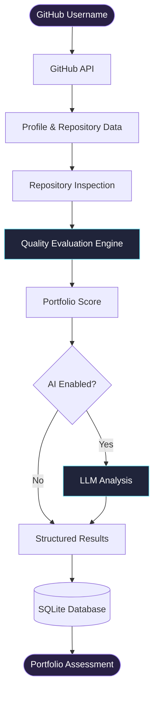

 <div align="center">

<a href="https://github.com/Shashikala-11/github-portfolio-reviwer">
  
</a>

<p>
  <strong>An AI-assisted GitHub portfolio evaluation platform.</strong>
  <br/>
  Analyze repository quality, identify development gaps, and understand your portfolio through structured insights.
</p>

<br/>

<a href="https://github.com/Shashikala-11/github-portfolio-reviwer">
  
</a>


<br/><br/>

[Overview](#overview) · [Features](#features) · [Architecture](#architecture) · [Tech Stack](#tech-stack) · [Installation](#installation)

<br/>

</div>

---

<div align="center">

## RETHINK YOUR GITHUB PORTFOLIO.

*Your repositories tell a story. Make sure it's a good one.*

</div>

## Overview

GitHub Portfolio Reviewer is an AI-assisted application designed to evaluate the quality and completeness of public GitHub portfolios.

It analyzes GitHub profiles and their repositories, checks essential development practices, and generates a structured portfolio assessment with a score out of 100.

Rather than evaluating a developer solely through repository count or stars, the project focuses on the engineering practices reflected in their repositories.

### The problem

A GitHub profile may contain multiple projects but still lack the fundamentals that make a developer portfolio professional.

- Incomplete project documentation.
- Missing repository configuration files.
- Lack of testing infrastructure.
- Missing CI/CD workflows.
- Absence of containerization support.

**The solution:** Automate these checks and turn repository information into actionable portfolio insights.

---

## Features

<table>
<tr>
<td width="50%" valign="top">

### Repository Intelligence

Analyze public repositories and inspect their structure and essential configuration files.

### Documentation Assessment

Evaluate README availability and repository documentation practices.

### Development Standards

Identify missing LICENSE, `.gitignore`, and CONTRIBUTING files.

</td>
<td width="50%" valign="top">

### Testing & CI/CD

Inspect testing infrastructure and continuous integration configurations.

### Docker Readiness

Check whether repositories include Docker-related configuration.

### Portfolio Scoring

Generate a structured quality score out of 100 using evaluation criteria.

</td>
</tr>
<tr>
<td colspan="2" valign="top">

### AI-Assisted Feedback

Use optional LLM integration to provide contextual insights alongside rule-based repository evaluation.

</td>
</tr>
</table>

---

## Evaluation Framework

The application evaluates repository quality across multiple dimensions.

| Category | Evaluation |
|:---|:---|
| Documentation | README availability |
| Licensing | LICENSE configuration |
| Repository Hygiene | `.gitignore` |
| Collaboration | CONTRIBUTING guidelines |
| Testing | Test infrastructure |
| Automation | CI/CD workflows |
| Containerization | Docker configuration |

<div align="center">

**Portfolio Quality Score**


<sub>The score represents an indicative assessment of repository practices, not a measurement of programming ability.</sub>

</div>

---

## Architecture

The project follows a modular architecture that separates GitHub data retrieval, repository evaluation, AI integration, and data persistence.



### Processing workflow

1. **Input:** Provide a public GitHub username.
2. **Data Retrieval:** Fetch profile and repository information.
3. **Inspection:** Examine repository files and development configurations.
4. **Evaluation:** Apply local quality checks.
5. **AI Analysis:** Generate optional contextual feedback.
6. **Persistence:** Store evaluation-related information using SQLite.
7. **Output:** Produce a structured portfolio assessment.

---

## Tech Stack

<div align="center">

| Technology | Purpose |
|:---|:---|
|  | Core application development |
|  | Public profile and repository data retrieval |
|  | Data persistence |
|  | Data validation and schemas |
|  | Optional AI-assisted analysis |
|  | Version control |

</div>

---

## Project Structure

```text
github-portfolio-reviwer/
│
├── app/
│   ├── config.py
│   ├── database.py
│   ├── github.py
│   ├── llm.py
│   ├── main.py
│   ├── models.py
│   └── schemas.py
│
├── requirements.txt
├── .gitignore
├── LICENSE
└── README.md
```

| Module | Responsibility |
|:---|:---|
| `config.py` | Application configuration |
| `database.py` | SQLite database operations |
| `github.py` | GitHub API communication |
| `llm.py` | Optional LLM integration |
| `main.py` | Application entry point and orchestration |
| `models.py` | Database models |
| `schemas.py` | Data validation schemas |

---

## Installation

### Prerequisites

- Python 3.9+
- Git
- GitHub account
- AI provider credentials, if using optional LLM functionality

**1. Clone the repository**

```bash
git clone https://github.com/Shashikala-11/github-portfolio-reviwer.git
```

**2. Navigate to the project directory**

```bash
cd github-portfolio-reviwer
```

**3. Create a virtual environment**

```bash
python -m venv venv
```

**4. Activate the environment**

Windows:

```bash
venv\Scripts\activate
```

Linux / macOS:

```bash
source venv/bin/activate
```

**5. Install dependencies**

```bash
pip install -r requirements.txt
```

**6. Configure environment variables**

Configure the credentials and settings required by your application. Keep API keys private and never commit them to Git.

**7. Run the application**

Use the configured entry point. If `app/main.py` is the executable entry point:

```bash
python -m app.main
```

---

## Engineering Considerations

- **Modularity:** Separate responsibilities make the application easier to maintain and extend.
- **Automation:** Repository checks reduce repetitive manual inspection.
- **Optional AI:** Core evaluation remains separate from LLM-generated feedback.
- **Structured validation:** Defined schemas help maintain consistent application data.
- **Local persistence:** SQLite provides lightweight data storage.

---

## Roadmap

- [ ] Interactive portfolio analytics dashboard
- [ ] Repository comparison and ranking
- [ ] Advanced README quality evaluation
- [ ] Historical score tracking
- [ ] Downloadable portfolio reports
- [ ] Expanded AI-generated recommendations
- [ ] Automated repository health monitoring

---

## Contributing

Contributions and suggestions are welcome.

1. Fork the repository.
2. Create a feature branch.
3. Implement your changes.
4. Commit and push your updates.
5. Submit a Pull Request.

For bugs and feature requests, visit [GitHub Issues](https://github.com/Shashikala-11/github-portfolio-reviwer/issues).

---

## License

Distributed under the MIT License. See [LICENSE](LICENSE) for details.

---

<div align="center">

### BUILT FOR DEVELOPERS WHO CARE ABOUT THE QUALITY OF THEIR WORK.

**GitHub Portfolio Reviewer**

<br/>

<a href="https://github.com/Shashikala-11/github-portfolio-reviwer">
  
</a>

<br/><br/>

<sub>Analyze · Evaluate · Improve</sub>

</div>
